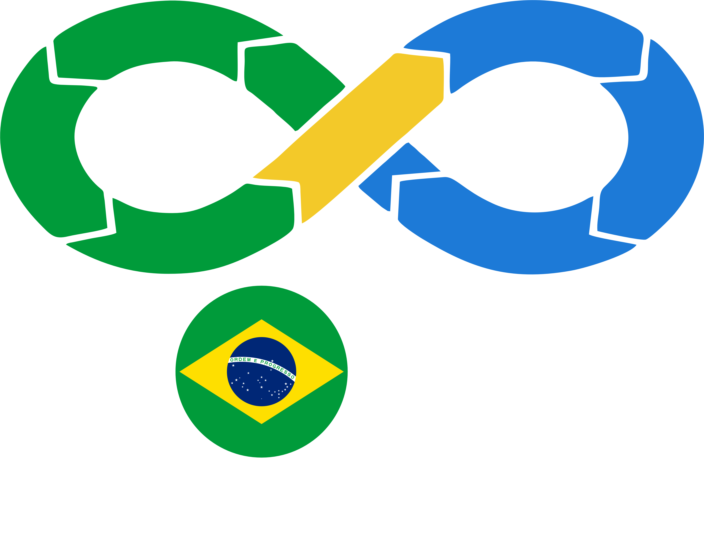
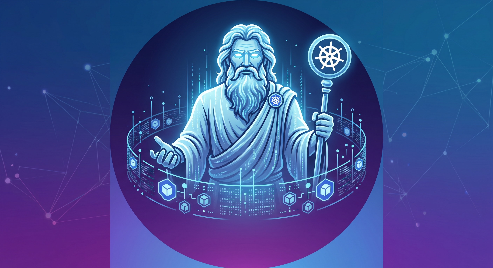
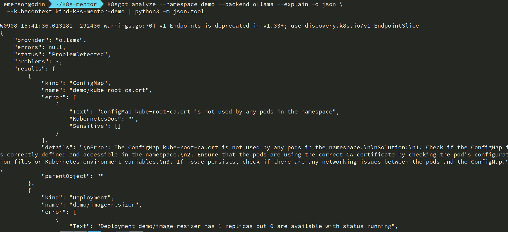
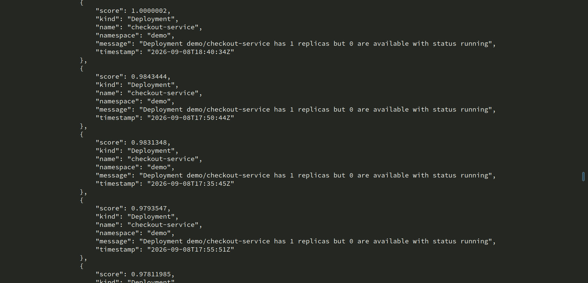
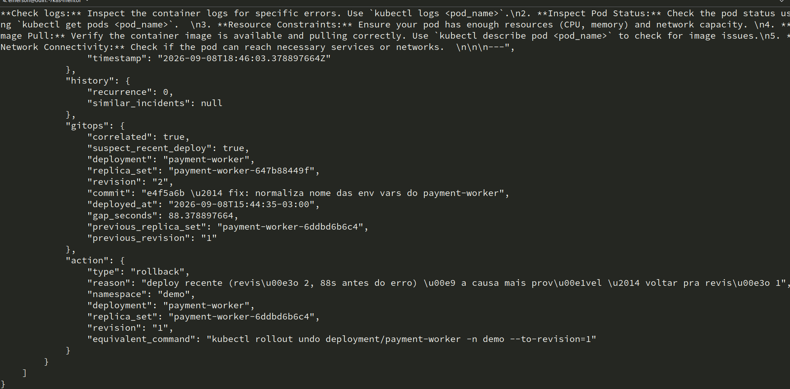
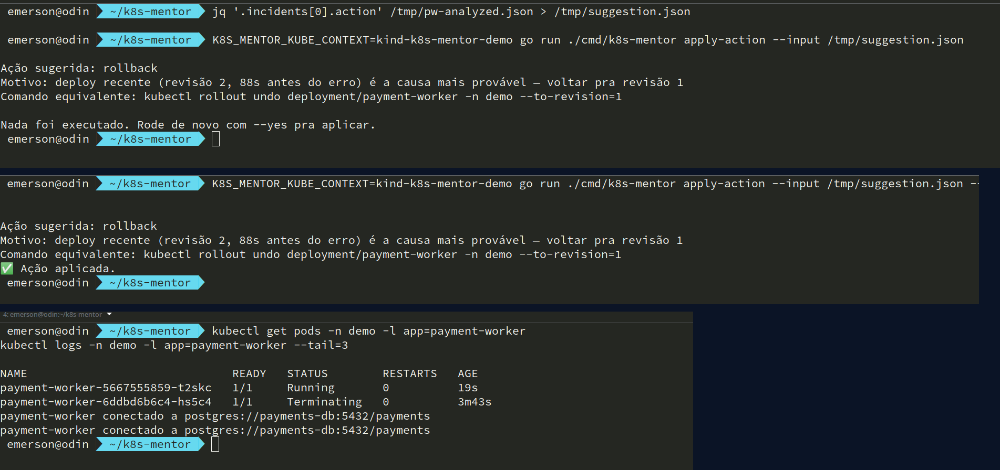
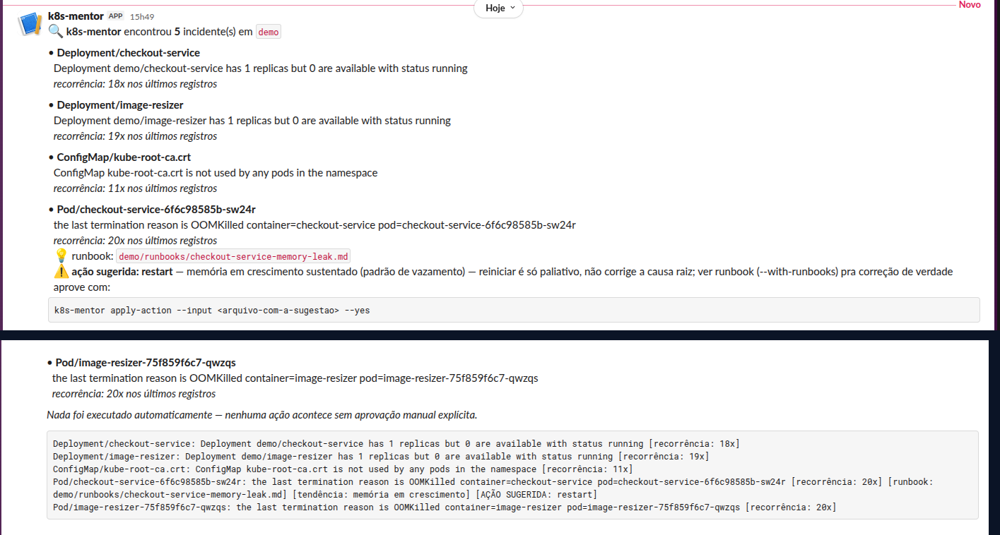

<!-- _paginate: false -->

# K8sGPT resolve 70% dos seus problemas.

## Vou te mostrar como resolver os outros 30% com um agente local

### Emerson Silva

  

---
<!-- _paginate: false -->

# 🇧🇷 Emerson Silva

* Engenheiro DevOps na **4Linux**
* +9 anos em ambientes DevOps críticos
* Foco em **Kubernetes**, IaC e confiabilidade
* Palestrante, instrutor,escritor , ex-zagueiro 
* Community Lead de Kubernetes na DOUGBrazil
* Organizador do CNCF Campinas

  
  

    
    
  

---

## Agenda

1. O que é o K8sGPT — e onde ele já acerta
2. O que falta, mesmo assim
3. O que é o k8s-mentor, e por que 100% local
4. Os 5 pilares — um print real por vez
5. Fase 6: rodando sozinho, avisando no Slack
6. Testado de verdade, e quem decide no final

---

O K8sGPT

# O que é o K8sGPT

Projeto **CNCF Sandbox** (aceito em dez/2023), Apache-2.0, escrito em Go.

- **8,2k stars** e **1,0k forks** no GitHub
- **14 analyzers** por padrão (Pod, Deployment, Service, Ingress, PVC, Node...) + 21 opcionais
- **15 backends de IA** — OpenAI, Azure, Bedrock... e local: **Ollama**, LocalAI
- Escaneia o cluster e traduz o problema em explicação legível

<!-- fonte: github.com/k8sgpt-ai/k8sgpt (stars/forks de set/2026) -->

---

O problema

# O que falta no K8sGPT

- **Stateless** — cada análise começa do zero
- Não sabe se **já aconteceu antes**, nem quantas vezes
- Não conhece o **runbook** que seu time escreveu
- Não correlaciona com **deploys recentes**
- Não vê **tendência** de métrica antes do crash

*Ele responde "o que quebrou". O humano ainda cata o "por quê" em 3 painéis — e isso consome horas de plantão que não precisavam ser gastas assim.*

---

A solução

# k8s-mentor

Roda **do lado** do K8sGPT (não substitui) e adiciona:

1. Memória de incidentes
2. RAG sobre runbooks internos
3. Correlação com deploys (GitOps)
4. Correlação com métricas (Prometheus)
5. Ação supervisionada — nunca decide sozinho

**100% local**: Ollama + Qdrant. Sem depender de API externa, sem expor dado sensível nem secret do cluster pra fora da rede.

<!--
diagrama de arquitetura vai aqui — reaproveitar o mermaid de
../docs/ARCHITECTURE.md#diagrama-de-componentes (renderizar como imagem)
-->

---

100% local

# Por que isso importa de verdade

- **Dado sensível não sai da rede** — nome de recurso, erro, runbook, secret mal higienizado num log
- **Sem custo por token** — rodando sozinho a cada 5min, uma API paga vira conta que ninguém previu
- **Sem depender de internet no incidente** — se o cluster caiu, sua saída pra nuvem pode ter caído junto
- **Sem vendor lock-in** — troca de modelo é `ollama pull`, não migração de contrato

---

Escolha de modelo

# Por que Qwen2.5

Ollama rodando **Qwen2.5**, Qdrant pra memória vetorial — os dois no mesmo cluster ou no laptop.

- **Roda sem GPU dedicada** — variantes pequenas cabem no laptop de demo
- **Segue formato de saída de forma consistente** — o pipeline inteiro depende de JSON bem formado voltando do modelo
- **Apache 2.0** — mesma licença do K8sGPT, stack open source de ponta a ponta

---

Por que "mentor"?

# O nome não é acaso

Na *Odisseia*, **Méntor** é o amigo a quem Ulisses confia seu filho Telêmaco antes de ir pra guerra — não pra decidir por ele, mas pra aconselhar.

Um mentor não aperta o botão por você. Ele **conhece seu histórico**, **já viu o problema antes**, **aponta o caminho** — a decisão final continua sua.

É exatamente o papel deste agente ao lado do K8sGPT.

---

Momento 1

# K8sGPT sozinho

<!-- print: k8sgpt analyze --explain -o json (checkout-service, OOMKilled) -->

---

## Quem faz o quê

**K8sGPT**

- Escaneia o cluster em tempo real
- Traduz erro críptico em explicação legível
- Cobre Pods, Deployments, PVCs, RBAC...
- Cada análise começa do zero

**k8s-mentor**

- Lembra do que já aconteceu antes
- Cruza com o runbook que seu time escreveu
- Aponta o deploy que provavelmente causou
- Confirma a tendência real na métrica

*Consome a saída do K8sGPT — não substitui, adiciona o contexto que falta.*

---

Momento 2

# Memória + RAG + Métricas

<!-- print: analyze --with-history --with-runbooks --with-metrics -->

---

## Mesmo erro, contexto real

- `recurrence: 9` — similaridade **semântica**, não palavra-chave
- Runbook certo achado: `checkout-service-memory-leak.md` (score 0.72)
- Prometheus confirma: memória em **crescimento sustentado**

---

Momento 3

# Ação supervisionada

<!-- print: analyze --with-gitops --with-action (payment-worker) -->

---

## Sugerir → aprovar → confirmar

<!-- print: apply-action preview + --yes + recuperação do pod -->

**Sugerir não é decidir. Quem aprova é humano, sempre.**

---

Fase 6

# Rodando sozinho, avisando no Slack

Até aqui, tudo rodou porque eu digitei um comando. Um `CronJob` dentro do próprio cluster roda o k8sgpt sozinho, passa pelos mesmos pilares e — quando acha algo — notifica um canal do Slack.

Repara o que a mensagem **não** faz: não diz "eu resolvi".
Diz o que sugere, o porquê, e o comando pra aprovar.

E notifica **com critério**: só interrompe o canal quando o padrão se confirma — recorrência, tendência de métrica ou ação sugerida. Evento isolado fica só no log.

---
<!-- _paginate: false -->
<!-- _footer: "" -->

<!-- print real: notificação do Slack já capturada nesta sessão -->

---

Credibilidade

# Isso é testado de verdade

Cada pilar foi validado contra um cluster **real** e a saída **real** do K8sGPT — não JSON forjado à mão:

- Parser ajustado ao formato real de saída do K8sGPT
- Thresholds de similaridade calibrados com dados reais, não texto de exemplo
- Detecção de tendência endurecida no caso real de vazamento de memória
- Correlação de métrica corrigida pra pegar a série certa no Prometheus
- Notificação do Slack com filtro de recorrência, pra avisar só o que importa

*Não é slideware. É a diferença entre uma demo que parece funcionar e uma que funciona.*

---

## Stack técnica

| Componente | Escolha |
|---|---|
| Agente | **Go** (ecossistema K8s nativo) |
| LLM local | **Ollama** + **Qwen2.5** |
| Memória vetorial | **Qdrant** |
| Cluster de demo | **Kind**, 3 nodes |
| Diagnóstico (fonte) | **K8sGPT**, desacoplado |

---
<!-- _paginate: false -->

# Quem decide?

Quanto mais forte o sinal — mais recorrência, mais correlação —
mais fácil é a tentação de deixar a máquina decidir sozinha.

**k8s-mentor foi desenhado pra resistir essa tentação.**

Ele fica mais inteligente. A decisão continua sendo sua.

---
<!-- _paginate: false -->

## Curso gratuito

### DevOps, AIOps e SRE Fundamentals

Curso gratuito da 4Linux

Escaneie o QR code pra se inscrever

* 🎓 4linux.com.br/cursos

---
<!-- _paginate: false -->

## Obrigado!

### Contato

* 🔗 github.com/silvemerson/k8s-mentor
* 📝 emerson-silva.blog.br
* 💼 linkedin.com/in/silvemerson

Vamos manter contato!

<!--
ARQUIVADO — slide institucional "Sobre a 4Linux" (timeline 2001→2024+), removido
do fluxo pra não abrir a talk com cara de slide comercial. A menção à 4Linux
agora é falada junto do "Quem sou eu" (ver roteiro-palestra.md). Reaproveite
este bloco (cole de volta como um slide entre "Quem sou eu" e "Agenda", com
--- antes e depois) se algum dia fizer sentido reintroduzir a versão longa.

## (arquivado) Sobre a 4Linux

Fundada em 2001, a 4Linux participou das principais transformações da área de tecnologia. Começamos com Linux e software livre, navegamos por Cloud, DevOps e Containers — e hoje atuamos com agentes de IA, sempre com base em **inovação aberta**.

  
2001Linux & Software Livre

  
2008DevOps

  
2016Containers & Kubernetes

  
2019Machine Learning

  
2020Cloud

  
2024+IA com Open Source

-->
